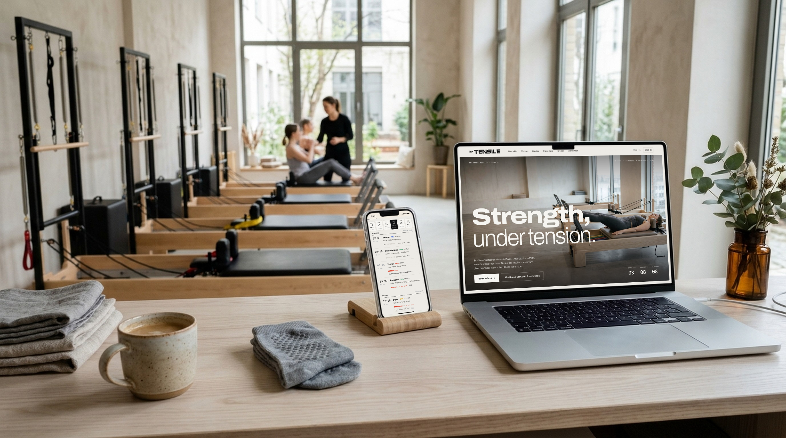

# Tensile — Next.js Reformer Pilates Studio Template

A production-ready booking website for a reformer Pilates or boutique fitness studio. Built with **Next.js 15**, **Tailwind CSS v4**, and the **Opencals Storefront SDK**.

**[View Live Demo →](https://template-reformer.vercel.app)**

<!-- TODO(lead): cover image -->


Technical but warm: Berlin concrete, soft north light, steel and ash wood. Plaster and ink surfaces, an expanded Archivo display face with IBM Plex Mono for the data, and the real **reformer spring colours** (green, yellow, blue, red) as the intensity language across the site. Set in **Berlin** (EUR, `Europe/Berlin`) with three studios (Mitte, Kreuzberg, Prenzlauer Berg) and live online classes, eight instructors, and every class capped at the number of beds in the room. Full storefront included: a live timetable with beds left and Full classes, a class sheet that turns into checkout, private 1:1 and duet sessions, workshops, studio and instructor pages, and passwordless accounts with a level path. MIT licensed: clone it, rebrand it, ship it.

---

## Get Started in 3 Steps

### 1. Create an Opencals account

Sign up at **[app.opencals.com](https://app.opencals.com)** and create a **Dev Store**. When prompted for a dataset, choose the **Reformer Pilates Studio** preset (category **Pilates & fitness**, seed dataset `reformer_studio`). It seeds your store with the three studios and Tensile at Home, eight instructors, the weekly timetable (one variant per class × studio × instructor, capped at the beds in each room), private 1:1 and duet sessions, three dated workshops, the add-ons (grip socks, towel hire, recovery shake), the checkout questions with a studio waiver, the intro offer, the off-peak discount and the `TENSILE10` code, and sample bookings (some classes are already full), so your template looks exactly like the demo.

### 2. Get your API key

Go to your **User Account Settings** in the Opencals dashboard and generate a **Storefront API key**. You'll need this to connect the template to your store. If you restrict the key to allowed origins, include your deployed domain.

### 3. Deploy to Vercel

[](https://vercel.com/new/clone?repository-url=https%3A%2F%2Fgithub.com%2Fletsopencals%2Ftemplate-reformer&env=OPENCALS_API_KEY,AUTH_SECRET&envDescription=API%20key%20from%20your%20Opencals%20dashboard%20and%20a%20random%20secret%20for%20auth&project-name=tensile&repository-name=template-reformer)

During deployment, Vercel will ask you to set environment variables:

| Variable | Value |
|----------|-------|
| `OPENCALS_API_KEY` | Your Storefront API key (starts with `sfk_`) |
| `AUTH_SECRET` | Any random string — used for session encryption |
| `NEXT_PUBLIC_STRIPE_PUBLISHABLE_KEY` | *(optional)* Stripe publishable key for payments |
| `NEXT_PUBLIC_SITE_URL` | *(optional)* Your domain, for the sitemap, canonical URLs and Open Graph |

That's it.

---

## The Storefront

<!-- TODO(lead): screenshots (homepage, timetable, class sheet, mobile) -->

---

## What's Included

<!-- TODO(lead): fill in once the pages land -->

### The Home Page
### The Timetable
### The Class Sheet and Checkout
### Privates and Workshops
### Studios, Classes and Instructors
### Your Account

Passwordless sign-in: customers enter their email and receive a 6-digit login code, or follow a magic link. One-time email links from Opencals (view, reschedule or cancel a booking, leave feedback) resolve through the `/link/[token]` route, which signs the customer in and redirects them to the right place.

> **Set your Storefront Base URL.** For emailed links to point back to this app, set **Storefront Base URL** in your Opencals dashboard (Settings → API) to your deployed URL (e.g. `https://your-domain.com`). Opencals builds every customer link as `{storefrontBaseUrl}/link/{token}`.

### Motion

Lenis smooth scrolling, a page transition, line-mask text reveals, tension cables that draw on, and a carriage-rail progress line, all moving like a reformer carriage returning on its springs. Every effect has a `prefers-reduced-motion` fallback.

### SEO Ready

Per-page metadata, Open Graph cards, `ExerciseGym` structured data with a `SportsActivityLocation` per studio, robots.txt and sitemap.xml, configured out of the box.

---

## The Class Model

Tensile uses existing Opencals features only. If you build your own studio, gym or class-based site, this is the pattern:

- **One product group per class type, one variant per class × studio × instructor.** `flow-mitte-lena` is Reformer Flow at Mitte with Lena. Each variant has its own schedule with one window per weekly start, its studio as the only location, its instructor as the only staff member, and `maxAttendees` = the beds in the room. So every timetable row names its teacher, and every class has its own capacity.
- **Rooms live in the template.** Rooms aren't API entities: `lib/site-config.ts` holds each studio's rooms (name, bed count, a rows × columns plan) and which room each class uses. The SVG room plans are drawn from that.
- **Full classes.** The availability API drops a slot once it's full. Classes repeat weekly, so the template learns each series' weekly pattern and shows a missing week as **Full**, with "next with space →" pointing at the next class of the same type with a free bed (`lib/timetable.ts`). Workshops are dated, so a full workshop simply disappears.
- **Privates.** A 1:1 and a duet per studio, one seat each, sharing one product pool per studio (one private room). A duet is one booking for two people, carried as the appointment custom attribute `people = "2"`.
- **Online classes.** A location of type `online` with a meeting link. The account shows a Join button from 10 minutes before the start.
- **Discounts.** An automatic intro offer (30% off a first order), an automatic off-peak discount (weekday classes starting 10:00–16:00) and a `TENSILE10` code. They don't stack: the best one wins.

---

## Tech Stack

| Category | Technology |
|----------|-----------|
| Framework | Next.js 15 (App Router) |
| Styling | Tailwind CSS v4 |
| Fonts | next/font: Archivo (variable, `wdth` axis), IBM Plex Mono |
| Animations | Framer Motion + Lenis |
| Data | SWR (client) + React Server Components |
| Forms | react-hook-form + Zod |
| Payments | Stripe Elements |
| Auth | NextAuth.js v5 |
| Dates | moment-timezone |
| Tests | Vitest |
| API | Opencals Storefront SDK (v0.3.18) |

---

## Local Development

```bash
git clone https://github.com/letsopencals/template-reformer.git
cd template-reformer
npm install
cp .env.example .env
```

Edit `.env` with your values:

```
OPENCALS_API_KEY=sfk_your_key_here
AUTH_SECRET=change_me_to_a_random_string
```

```bash
npm run dev
```

Open [http://localhost:3000](http://localhost:3000).

Checks: `npm run typecheck`, `npm run lint` and `npm test` (vitest, including the timetable and Full-inference maths in `lib/timetable.test.ts`).

---

## Customization

### Branding & Content

- **`lib/site-config.ts`** — name, tagline, contact, studios (rooms, bed plans, copy, photos), instructor bios, class meta (spring, level, what to bring, room per studio), the level path, policies, the off-peak window and add-on copy.
- The bookable data (classes, prices, capacities, instructors, studios, availability, add-ons, checkout questions, discounts) comes from your Opencals store.

### Theme

Design tokens live in **`app/globals.css`** as Tailwind v4 `@theme` properties. The full design system (type scale, motifs, motion, z-index map) is in **`DESIGN.md`**.

```css
@theme {
  --color-plaster: #edebe6;       /* page */
  --color-paper: #f6f5f1;         /* cards */
  --color-ink: #121212;           /* text and primary buttons */
  --color-spring-green: #3e9b6a;  /* gentle */
  --color-spring-yellow: #e2b42e; /* flowing */
  --color-spring-blue: #2f5bd3;   /* strong */
  --color-spring-red: #d9412b;    /* heavy, and urgency */
}
```

### Imagery

Every image sits in an `.image-placeholder` container and renders through `SafeImage`, so a missing file falls back to a pale concrete placeholder. **Class photos, instructor portraits, the banner and the logo come from your Opencals store.** Editorial art ships in `public/images/` and the hero film in `public/videos/`.

---

## Project Structure

```
app/
  page.tsx                     # Home
  timetable/                   # The week, filters, bed pips, Full + next with space
  classes/ studios/ instructors/
  privates/ workshops/
  checkout/ thank-you/         # Checkout and the check-in pass
  account/                     # Your week, booking pages, settings
  login/ link/[token]/         # Sign in by code, one-time email links
  api/                         # API routes proxy SDK calls server-side

components/
  motifs/                      # Spring chips, bed pips, room plans, tension cables, carriage rail
  motion/ layout/ ui/          # Motion, header/footer, primitives
  cart/ checkout/ auth/

lib/                           # site-config, catalog, timetable, level-path, server-data, opencals, auth
```

## Environment Variables

| Variable | Required | Description |
|----------|----------|-------------|
| `OPENCALS_API_KEY` | Yes | Storefront API key from your Opencals dashboard |
| `AUTH_SECRET` | Yes | Random string for NextAuth session encryption |
| `NEXT_PUBLIC_STRIPE_PUBLISHABLE_KEY` | No | Stripe publishable key for payment processing |
| `NEXT_PUBLIC_SITE_URL` | No | Public site URL for metadata, sitemap and JSON-LD |
| `OPENCALS_API_URL` | No | Override API base URL (defaults to production) |

---

## Other Templates

Tensile is one of the open-source booking templates built on the Opencals Storefront SDK. Same backend, different design and vertical:

- **[Clear Care](https://github.com/letsopencals/template-clarity)** — a medical clinic template with department-first booking. [Live demo](https://template-clarity.vercel.app)
- **[Frisor](https://github.com/letsopencals/template-frisor)** — a modern barbershop template with a dark editorial palette. [Live demo](https://template-frisor-sage.vercel.app)
- **[HAAR](https://github.com/letsopencals/template-haar)** — a hair-salon booking template with a light, warm palette. [Live demo](https://template-haar.vercel.app)
- **[VOLT](https://github.com/letsopencals/template-volt)** — a padel & squash club template with a court booking grid. [Live demo](https://template-volt.vercel.app)
- **[NOIR Drive](https://github.com/letsopencals/template-noir)** — a luxury car-rental template (Dubai) with multi-day rentals and chauffeur packages. [Live demo](https://template-noir.vercel.app)
- **[Fluently](https://github.com/letsopencals/template-fluently)** — a language-school template (New York) with group classes, live seats, private lessons and online lessons. [Live demo](https://template-fluently.vercel.app)
- **[Lumbung Sidemen](https://github.com/letsopencals/template-bali-villas)** — a Bali villa-rental template with nightly stays and fixed check-in. [Live demo](https://template-bali-villas.vercel.app)

See all templates and the Storefront API at **[opencals.com/developers](https://opencals.com/developers)**.

## Build with AI

Prefer to let an AI agent do the heavy lifting? Install the **[Opencals Agent Skills](https://github.com/letsopencals/skills)** in Claude Code, Cursor, Codex or Gemini CLI:

- **`opencals-build-booking-site`** — scaffold, wire and deploy a template like this one (see `references/classes-and-lessons.md` for the class, capacity and Full-class pattern)
- **`opencals-storefront-api`** — ground-truth reference for the Opencals API & SDK

Docs: **[opencals.com/docs → AI Agents](https://opencals.com/docs/ai-agents/overview)**.

## License

MIT
